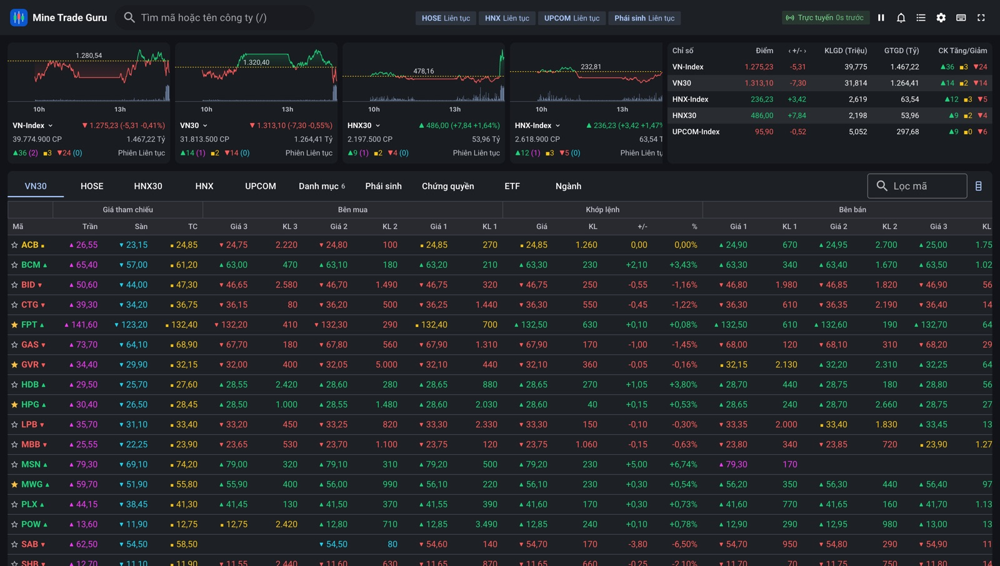
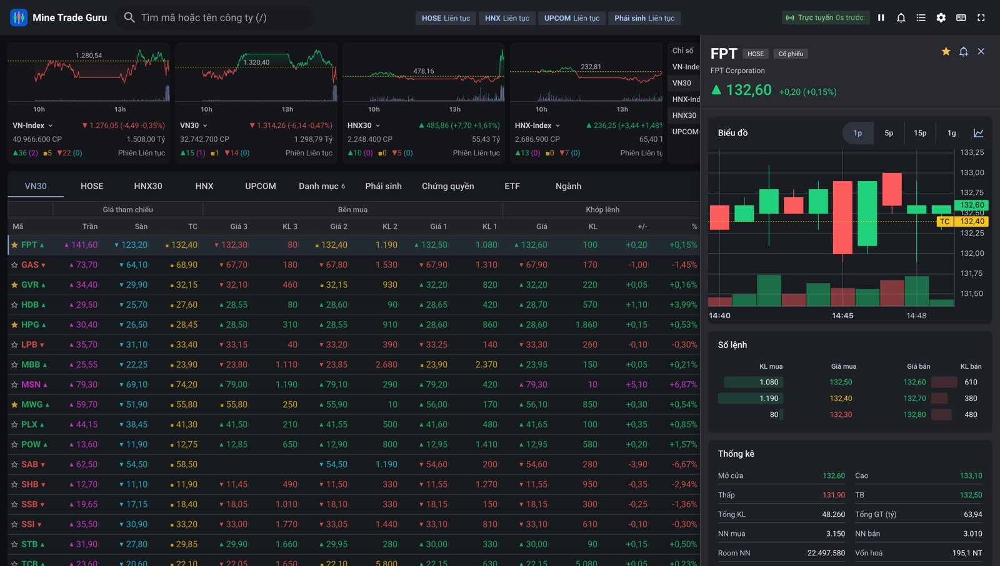
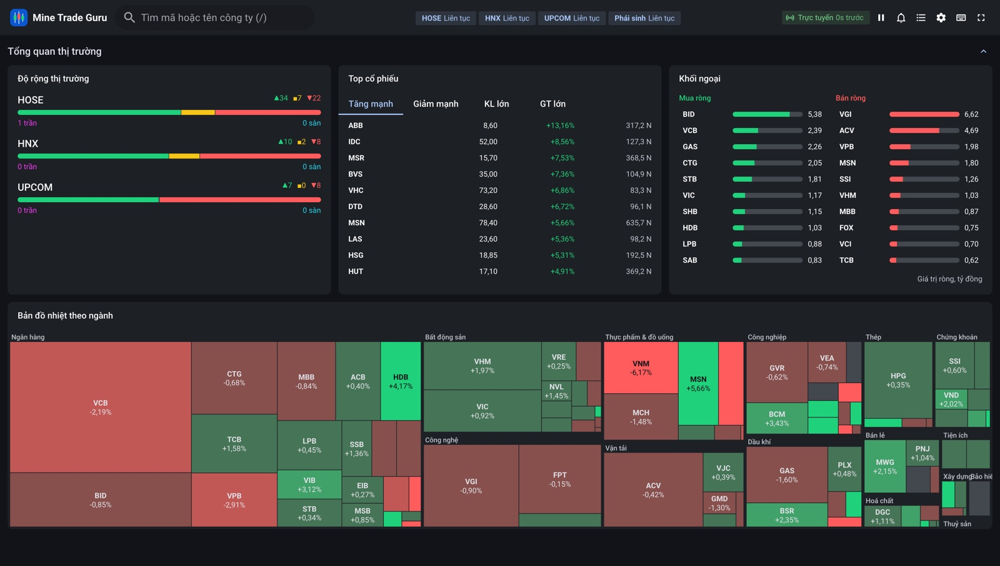
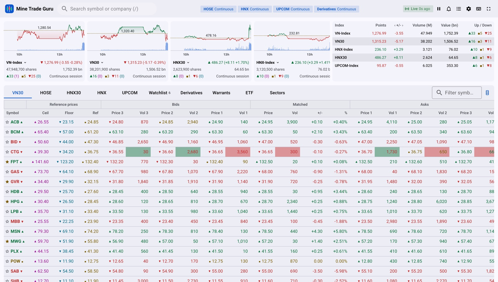
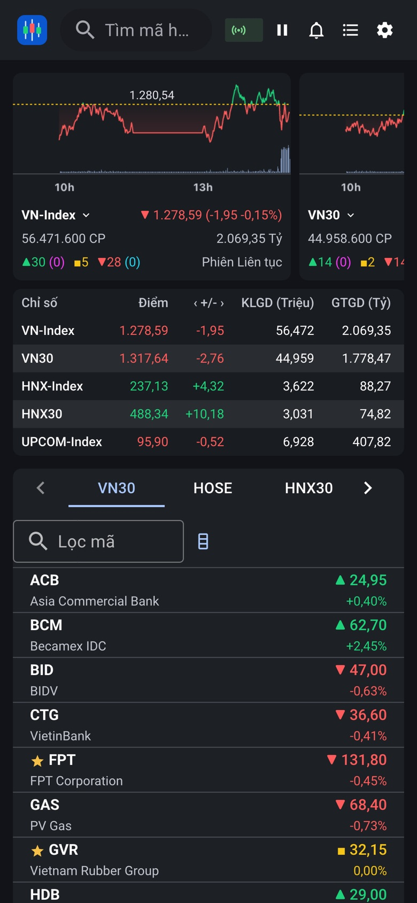

# Mine Trade Guru

A real-time Vietnamese stock price board in the style of SSI iBoard, built with
Vue 3 and Vuetify (Material Design 3). The backend is a market simulator that speaks
SSI FastConnect's channel format, since real FastConnect credentials need KYC.



What you get:

- The full iBoard layout: ceiling/floor/reference, three bid and ask levels, matched
  price and volume, totals, OHLC and foreign flow, with the five VN price colors
  plus ▲ ▼ ■ markers so color is never the only cue.
- Boards for VN30, HOSE, HNX30, HNX, UPCOM, watchlist, derivatives, covered
  warrants, ETF and sectors. You can sort, pin rows, and show, hide or reorder
  column groups.
- iBoard-style index header: four intraday charts (09h–15h, green/red around the
  reference, volume bars; each card can switch index) and a table of all indices.
- Market breadth, top movers, foreign flow and a sector heatmap.
- Symbol drawer with candles (1m/5m/15m/1h), order-book depth, time & sales, volume by
  price and key stats.
- Watchlists with CSV import/export, price alerts (toast, sound, browser notification),
  global search, keyboard shortcuts, light/dark theme, Vietnamese/English.

## Screenshots

All taken from the Docker build with the simulator running, so prices are live and
changed cells flash.

**Symbol detail.** Click any row: candles with the reference line, order book, key stats,
then time & sales and volume by price below.



**Market overview.** Breadth per exchange, top movers, foreign flow and a sector heatmap
sized by market cap.



**Light theme, English.** Both M3 schemes, with market colors tuned to pass WCAG AA on
each. Here two cells in the CTG row are mid-flash.



**Phone.** Under 600 px the board becomes a card list and the header drops the
desktop-only buttons.



## Run it

With Docker:

```bash
docker compose up --build
# open http://localhost:8081
```

Locally (Node 22+):

```bash
cd backend && npm install && SESSION_MODE=always-open npm run dev   # :8080
cd frontend && npm install --legacy-peer-deps && npm run dev        # :5173
```

`SESSION_MODE=simulated` follows the real HOSE/HNX timetable instead (prices only move
in trading hours, Vietnam time). If the frontend runs on another port, add it to the
backend's `ALLOWED_ORIGINS`.

Stress mode (1,500 symbols × 5 updates/s): `npm run dev:stress` in `backend/`. In dev
builds a small overlay in the bottom-left shows tick-to-paint latency and frame stats.

## Checks

| | Frontend | Backend |
|---|---|---|
| Types | `npm run typecheck` | `npm run typecheck` |
| Lint | `npm run lint` (ESLint + Stylelint) | `npm run lint` |
| Unit tests | `npm run test:unit` (`npm run coverage` for the 80 % gate) | `npm run test:unit` |
| E2E | `npm run test:e2e` (uses your installed Chrome, starts its own servers) | |
| Build | `npm run build` | `npm run build` |

## Docs

- [docs/plan.md](docs/plan.md): requirements (FR/NFR), architecture, code rules
- [docs/architecture/README.md](docs/architecture/README.md): the short version
- [docs/design-system.md](docs/design-system.md): M3 colors, tokens, CSS rules
- [docs/performance.md](docs/performance.md): measured results

## Real data later

The simulator sits behind the backend's `MarketDataSource` interface. A real SSI
FastConnect adapter would implement that interface in the backend, keeping the secret
server-side; the browser protocol and the whole frontend stay the same.

The simulator starts each day empty, so on startup it backfills the index charts from
09:00 to now with a synthetic path that ends at the live value. Card and table totals
(volume, value) only count trades since startup.
